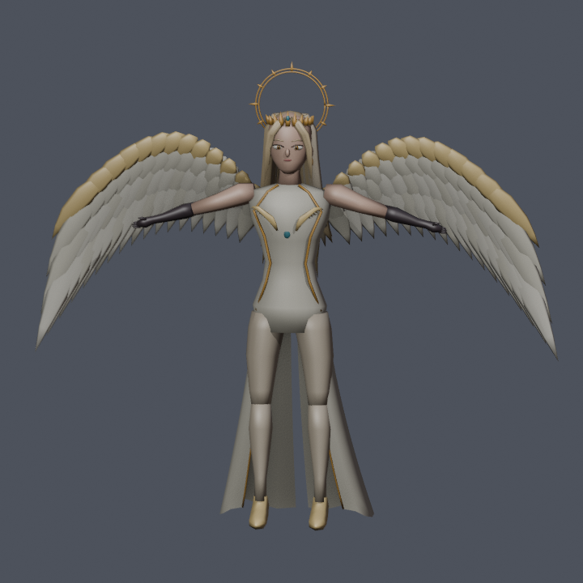

# Moon Seraph · 白金翼角色原型

- `Moon-Seraph.blend` 是 Blender 4.3.2 可编辑源文件。
- `Moon-Seraph.glb` 是带蒙皮骨架的游戏交换文件。角色由 10 个网格、19 根骨骼和 25,002 个三角形组成。
- 在 Blender 中播放 `Wings_Fold_Spread`，第 1、48、96 帧分别为收翼、全展和收翼。GLB 已重新导入 Blender 验证。iOS SceneKit 导入、战斗动作映射与真机帧率待验证。
