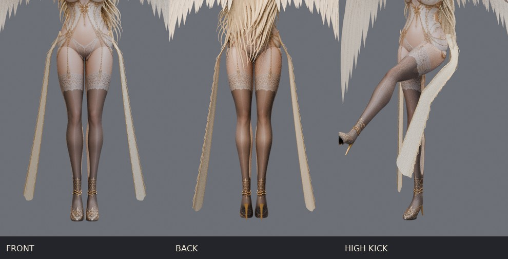

# Moon Seraph · 战斗裙摆修订 03.1

[模型 GLB](Moon-Seraph.glb) · [Blender 源文件](Moon-Seraph.blend) · [脸部近景](Seraph-Portrait.jpg) · [第二、三版脸部对照](Seraph-Comparison.jpg)

两片披纱移至双腿外后侧，前后中线留空。披纱、金边和刺绣按高度共享同侧髋、大腿和小腿的渐变权重。

将两版 GLB 分别重新导入 Blender，测试待机、抬腿、前踢、侧闪、收势五组姿势。每组采左右镜像及六个插值位置，比较裙摆（含饰边）与双腿和鞋的网格交叉。旧版各组最大相交面片对数为 226、234、246、552、420；修订版均为 0。Moon Action 真机动画重定向及实机显示仍待验证。

[第三版全身美术存档（旧裙摆）](Moon-Seraph.png)。