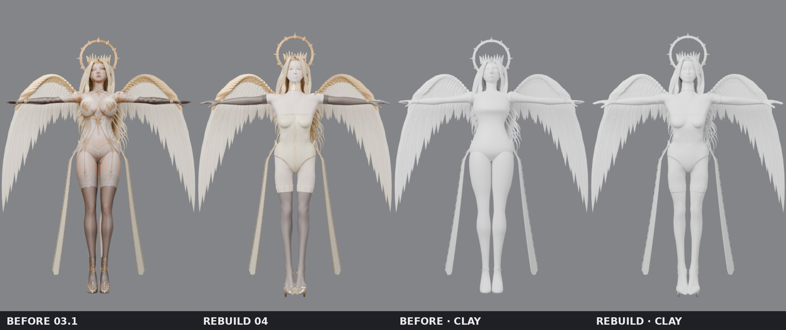

# Moon Seraph · 建模重制 04



[模型 GLB](Moon-Seraph.glb) · [Blender 源文件](Moon-Seraph.blend) · [白模细节对比](Seraph-Rebuild-Clay.jpg) · [近景、背面与战斗姿势](Seraph-Rebuild-Poses.jpg) · [重建脚本](tools/)

## 这一版改了什么

03.1 的身体只是低模外壳，细节靠一张投影贴图：躯干 1344 面，手是尖锥，没有手指，脚是圆块，五官和胸衣都是画上去的。04 把身体换成真正建模的几何体，羽翼、长发、王冠、光环、披纱和金饰沿用原件，重新坐到新身体上。

- **身体**：用 CC0 的 MakeHuman hm08 基础网格（13k 四边面，拓扑完整），套用女性比例和脸型目标：椭圆脸、短下巴、细鼻、丰唇、杏眼上挑、高颧骨、细颈。然后按原 Seraph 骨架摆成 T 姿势，脚背绷直成高跟角度，脚趾放平。头和手只做刚体变换，不拉伸。
- **手和脚**：五指完整，每根手指 3 节骨骼；脚趾 1 根骨骼。
- **脸**：眼窝、眼睑、鼻、唇、下颌都是实体几何。另有琥珀色眼球（沿用原虹膜贴图）、34 根上睫毛、发丝眉毛，以及额心和泪痕金饰（浮雕几何，不是贴图）。
- **服装改为建模**：
  - 象牙织锦胸衣（带厚度，边缘包金线）；
  - 高领蕾丝颈圈；
  - 大腿蕾丝袜口（扇贝边）；
  - 长手套和蕾丝袖口；
  - 尖头细高跟鞋（鞋型按脚截面拟合，鞋口开在脚背，鞋头收尖，鞋跟是独立细跟）。
  - 手套和丝袜是贴身的半透材质区域，所以手指和腿形保持清晰。
- **原件重新就位**：新头骨比原来高 2.6 cm，长发的眼线以上部分按新头型拉伸，王冠和光环整体上移，眼线以下不动。

## 骨架与 Moon Action

- 保留全部原骨骼名（`Hips` `Spine` `Neck` `Head` `Arm.L` `Forearm.L` `Hand.L` `Thigh.L` `Shin.L` `Foot.L`、羽翼、长发、披纱等），Moon Action 的重定向表照常识别。
- 新增 30 根手指骨和 2 根脚趾骨，名称不与重定向表冲突。
- 身体权重来自 MakeHuman 默认骨架权重，按区域合并到上述骨骼；左右分件（鞋、袜口、袖口）只从同侧取权重。
- 高抬腿和侧闪两组姿势已渲染检查：拉伸零件 0 个，零权重顶点 0 个。
- GLB 约 8.2 MB、22.6 万三角面（03.1 为 7.6 MB、20.3 万）。导出时程序化材质（妆面、半透丝袜和手套、织锦、眼球）烘焙成贴图，细分只在渲染时生效，游戏内用的是基础网格。
- Moon Action 真机显示仍待验证。

## 重新生成

```bash
pip install bpy                                    # Blender 5.x 的 Python 模块
tools/fetch_makehuman_assets.sh tools/mh           # 下载 CC0 MakeHuman 资源（不入库）
git show bda5635:Seraph/Moon-Seraph.blend > /tmp/seraph-03.blend   # 03.1 版作为输入
python tools/rebuild_seraph.py -- --src /tmp/seraph-03.blend --mh tools/mh --out Moon-Seraph.blend
python tools/export_glb.py -- Moon-Seraph.blend Moon-Seraph.glb
```

MakeHuman 的基础网格、形状目标、骨架、权重和眼球均为 CC0 1.0（见 MakeHuman 仓库 LICENSE.md 第 C 节）。

## 存档

- [03.1 战斗裙摆验收](Seraph-Battle-Hem.jpg) · [03 脸部对照](Seraph-Comparison.jpg) · [03 脸部近景](Seraph-Portrait.jpg) · [03 全身美术](Moon-Seraph.png)
