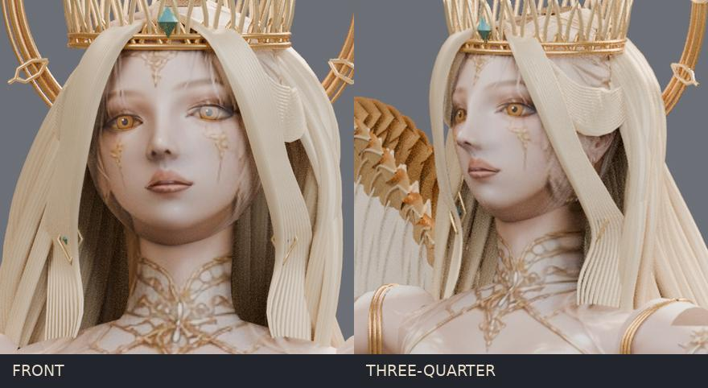

# Moon Seraph · 角色研究 03

[同角度对照](Seraph-Comparison.jpg) · [全身与背面](Moon-Seraph.png) · [Blender 源文件](Moon-Seraph.blend) · [GLB 模型](Moon-Seraph.glb)

新增面部多视角贴图、立体眼睑和唇形、琥珀色虹膜以及带发骨的波浪长发。GLB 有 17 个网格、30 根骨骼、7 张贴图、203,228 个三角形。Blender 回导验证收翼、展翼和再次收翼的翼展为 0.558、1.523 和 0.558 个场景单位。当前为静态面部美术评审版；眨眼、表情和 iPhone 真机性能待验收。
